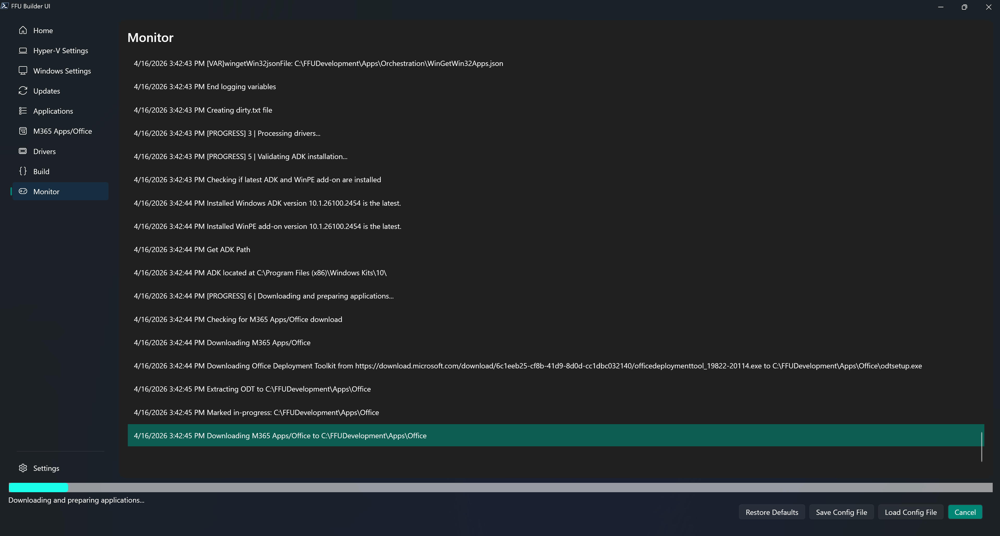

# Monitor

The monitor tab parses the `.\FFUDevelopment\FFUDevelopment.log` file. This makes it easy to track what's happening during the FFU build process.

You can click into the monitor and select one or multiple lines (either single click, or shift+click). Doing so will prevent the log file from continuous scrolling, allowing you time to read what has transpired up to that point.

You can also copy your selection using ctrl+C. This makes it easy to copy and paste parts of the log file used for troubleshooting.

## Build VM failures

If the guest reports an error, the VM doesn't shut down within **VM Timeout** (3 hours by default), or Windows isn't generalized for OOBE after shutdown, FFU Builder stops without capturing.

FFU Builder saves available diagnostics in `FFUDevelopment\Diagnostics\BuildVM\<VM name>`. The diagnostic files are retained after failure and aren't removed

The following logs are collected:

**Host**

- `.\FFUDevelopment.log`
- `.\FFUDevelopment_UI.log`
- `.\dism.log` (only the entries from the FFU Builder run)

**Guest**

- `Windows\Temp\FFUBuildVmFailure.json`
- `Windows\Temp\FFUOrchestrationBootstrap.log`
- `Windows\Temp\FFUSysprepRetry.log`
- `Windows\Temp\FFUDataPartitionDriveLetters.log`
- `Windows\Setup\Scripts\FFUDL\Audit.failure`
- `Windows\Setup\State\State.ini`
- `Windows\Panther\setupact.log`
- `Windows\Panther\setuperr.log`
- `Windows\Panther\UnattendGC\setupact.log`
- `Windows\Panther\UnattendGC\setuperr.log`
- `Windows\System32\Sysprep\Panther\setupact.log`
- `Windows\System32\Sysprep\Panther\setuperr.log`
- `Windows\System32\winevt\Logs\System.evtx`
- `Windows\System32\winevt\Logs\Setup.evtx`
- `Windows\System32\winevt\Logs\Application.evtx`
- `Windows\Logs\CBS\CBS.log`
- `Windows\Logs\CBS\CbsPersist_*.cab`
- `Windows\Logs\CBS\CbsPersist_*.log`


